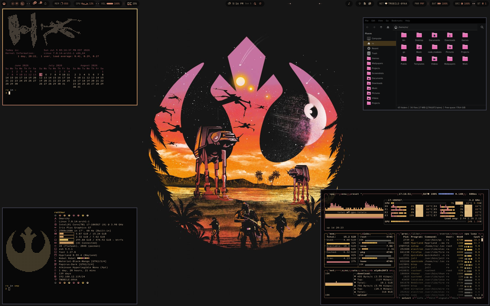
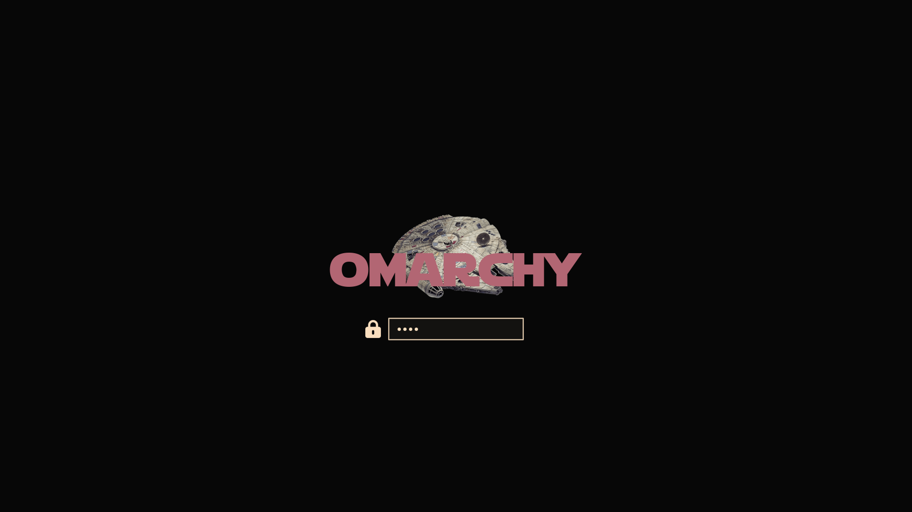

# Rebel, Rebel Theme

An Omarchy Theme for your Arch Linux / Hyprland setup based on Disney/Lucasfilms Star Wars





## Installation

To install this theme, simply use the ``omarchy-theme-install``   
command: `` omarchy-theme-install https://github.com/signaldirective/rebel-rebel ``  

Or with the current Omarchy CLI:

```bash
omarchy theme install https://github.com/signaldirective/rebel-rebel
omarchy theme set rebel-rebel
```

## Plymouth unlock screen

The theme ships a Plymouth unlock logo (`unlock.png`) with its catalogue preview.
It is not applied automatically. Choose the theme from **Omarchy → Style → Unlock**, or run:

```bash
omarchy plymouth set by theme rebel-rebel
```

This command requires `sudo` and rebuilds the initramfs. Use `omarchy plymouth reset` to restore the default unlock screen.

## Extras

Optional Fastfetch artwork and configuration are included in `extras/`; see `extras/instructions.txt`.

**Theme by Signal Directive**
**Additional Credits:** HANCORE for the quickshell theme, you can find it on [HANCORE's github](https://github.com/HANCORE-linux/quickshell-dots) and add the Rebel Alliance glyph yourself in the Theme.qml  


Like my work? Buy me a [coffee!](https://ko-fi.com/signaldirective)
